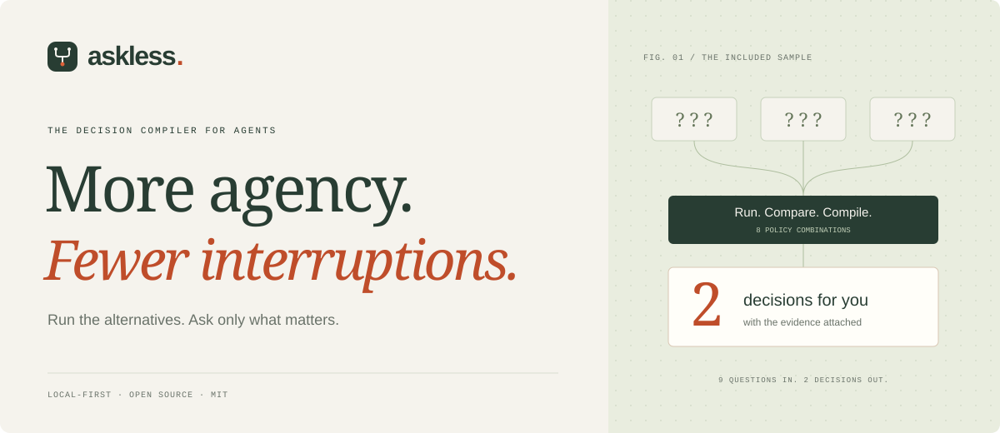
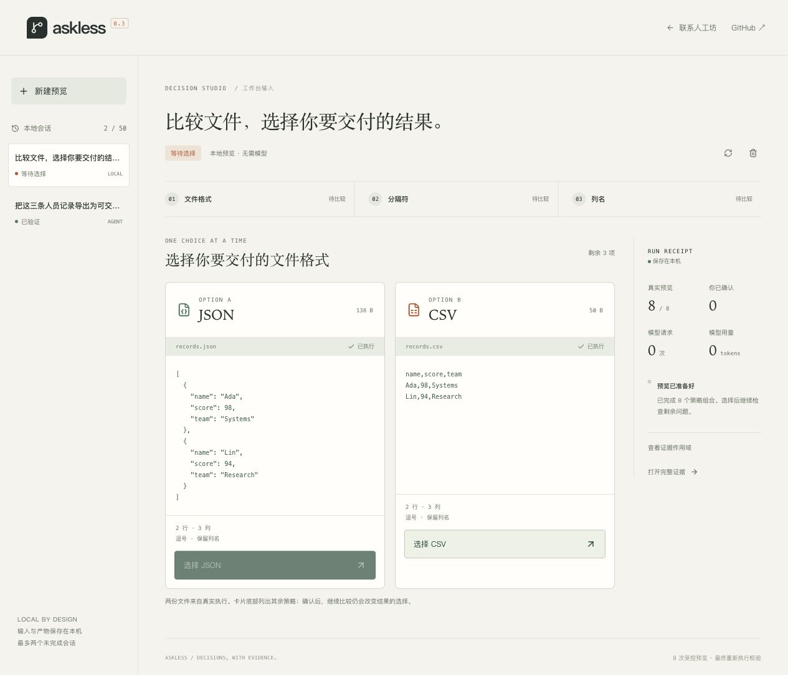
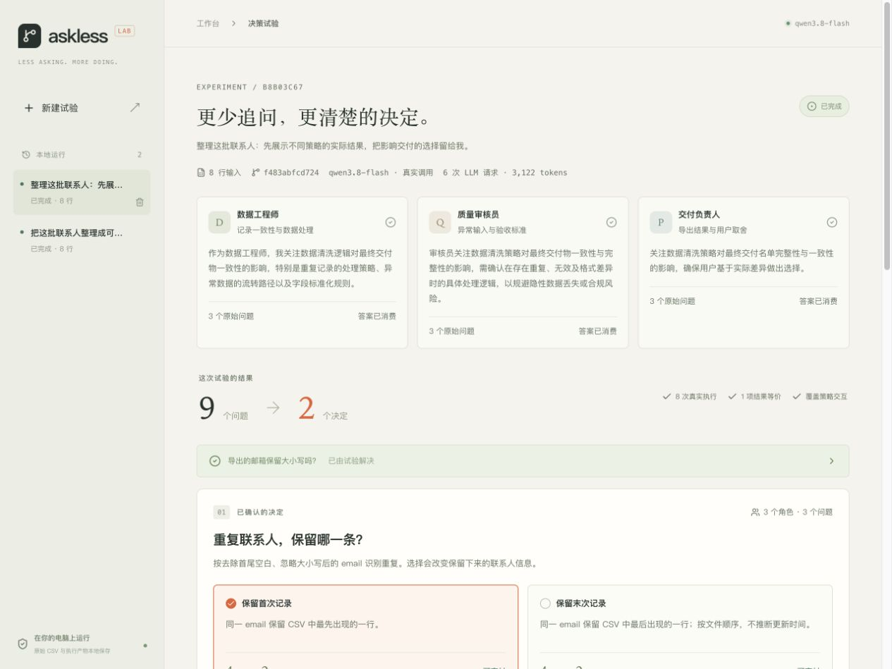

<p align="center">
  <a href="https://oyyp.nexa-lang.com/askless/"></a>
</p>

<p align="center">
  <a href="https://oyyp.nexa-lang.com/askless/"><strong>Website & interactive example ↗</strong></a>
  &nbsp; · &nbsp;
  <a href="#quickstart">Quickstart</a>
  &nbsp; · &nbsp;
  <a href="docs/python-sdk.md">Python SDK</a>
  &nbsp; · &nbsp;
  <a href="README.zh-CN.md">中文</a>
</p>

<p align="center"><sub>LOCAL-FIRST &nbsp; / &nbsp; MIT LICENSED &nbsp; / &nbsp; PYTHON + MCP v0.3</sub></p>

<br />

## Your attention deserves a better interface.

**Let agents spend compute before they spend your attention.**

AskLess runs finite alternatives, compares their actual outputs, and brings you the choices that change the result—with evidence attached. Embed it in a Python data workflow, inspect the remaining decisions, and verify the selected policy before continuing.

**New in v0.3: choose the result, then continue.** A file-preview workbench, real MCP tools and a restartable Python agent. Answer one question and AskLess checks whether the remaining questions still matter. The Python SDK, order reports and contact workflow remain available.

| Collect | Explore | Decide |
| :--- | :--- | :--- |
| **3 export choices** | **8 complete policy combinations** | **1 choice when you select JSON** |
| Format · delimiter · column names | Compare actual file bytes and metadata. | The two CSV-specific choices resolve automatically. CSV keeps relevant choices. |

<sub>Three synthetic records in the public replay. The trusted exporter runs eight previews and one final replay. Human time remains an open evaluation question.</sub>

<br />

<a href="https://oyyp.nexa-lang.com/askless/#file-export"></a>

<p align="center"><sub>Actual local workbench · <a href="https://oyyp.nexa-lang.com/askless/#file-export">Try the recorded file comparison ↗</a></sub></p>

## Quickstart

For the visual workflow, install **Python 3.12+**, **uv**, **Node.js 24.15+** (or 22.22.2+) and **pnpm 12**:

```bash
git clone https://github.com/ouyangyipeng/askless.git
cd askless
./run.sh
```

Open **[127.0.0.1:8765/decisions](http://127.0.0.1:8765/decisions)**. Paste a flat JSON array or use the sample, prepare the files, and choose JSON. Delimiter and column-name questions disappear. Click the replay button to verify and download the file. This path makes **zero model requests**.

To use the reference LLM agent, keep the workbench running and launch this in a second terminal with the [provider environment](#connect-a-real-llm) configured:

```bash
uv run --extra agent python -m askless.agent --input examples/records.json
# Choose in the printed workbench URL, then run the printed resume command.
uv run --extra agent python -m askless.agent --resume YOUR_SESSION_ID
```

The agent invokes real MCP tools and persists its progress. It uses one bounded model action before preview and another before collection; file rows stay local. `--wait 120` keeps it waiting briefly for your choice. [Complete setup, host configuration and recovery →](docs/agent-workflow.md)

## Python-only quickstart

You need **Python 3.12+** and [uv](https://docs.astral.sh/uv/getting-started/installation/).

```bash
git clone https://github.com/ouyangyipeng/askless.git
cd askless
uv sync --frozen
uv run python -m askless.demo \
  --choose duplicates=last \
  --choose cancelled=exclude
```

Open the **`report.html` path printed in your terminal**. The report shows every decision, witness outputs, execution cost and final result. `report.json` contains the full evidence; `result.json` contains four included orders totalling **USD 120.00**. Reports go into a new local `artifacts/orders-*` directory on each run.

The default mode replays one declared question per contract and makes **zero LLM calls**. Use `--input path/to/orders.json` for your own data; omit `--choose` to answer interactively. In noninteractive use, missing choices produce a pending report and exit code 2. See the [input format and CLI guide](docs/python-sdk.md#try-the-included-workflow).

## Put it inside your agent

For incremental decisions, use `run.progress().answer(key, value)`. Each answer filters existing evidence and recomputes the remaining choices. `progress.resolve(inputs=...)` verifies the final output once all relevant choices are settled. See the [conditional-decision example](docs/python-sdk.md#conditional-decisions).

```python
from pathlib import Path

from askless import explore
from askless.orders import ORDER_DECISIONS, load_orders, preview_orders

data = load_orders(Path("examples/orders.json"))
run = explore(
    adapter="order-summary/v1",
    inputs=data,
    decisions=ORDER_DECISIONS,
    preview=preview_orders,
)

for group in run.pending:
    print(group.decision.prompt, group.decision.options)

# Collect these answers from your user, then verify the selected result.
result = run.resolve({"duplicates": "last", "cancelled": "exclude"}, inputs=data)
print(result.output)
```

Replace the decisions and preview with your own pure function. `Decision` supports 2–8 options; `AgentQuestion` attaches an actual agent's question to a contract. All registered contracts are checked even if the agent omits one. See the [complete custom-function example](docs/python-sdk.md#wrap-your-own-function).

```text
  Your input + finite choices + pure preview
                      │
            Execute every combination
                      │
          Compare every decision interaction
                      │
            ┌─────────┴─────────┐
            ▼                   ▼
      Equal outcomes      Different outcomes
      Resolve locally     Ask with witnesses
            └─────────┬─────────┘
                      ▼
           Replay the selected policy
                      │
           Exact output match → continue
```

**The trade-off is visible.** The order sample takes eight previews plus one final replay, compared with one direct execution after all choices are known. The report measures both paths using the same input and final policy.

**The scope is explicit.** Equality covers the complete JSON result on the input snapshot and across every policy interaction. Previews run trusted code in your process. The SDK bounds combinations and retained JSON; your application controls callback time, peak memory and side effects. [Execution contract →](docs/python-sdk.md#execution-and-resource-contract)

## Connect a real LLM

Add `--live` to the demo command. The order agent proposes relevant questions from aggregate statistics; it may ask about any subset of the contracts. All previews and final verification stay local.

The backend reads credentials from its process environment. Export your credential through your usual secure shell setup before launching. Supported configuration:

| Variable | Purpose |
| :--- | :--- |
| `ALIYUN_API_KEY` | API credential; falls back to `DASHSCOPE_API_KEY` |
| `ALIYUN_BASE_URL` | HTTPS OpenAI-compatible endpoint; defaults to `https://dashscope.aliyuncs.com/compatible-mode/v1` |
| `ASKLESS_MODEL` | Model name; defaults to `qwen3.8-flash`. Choose a model available to your account. |

The provider must support Chat Completions, JSON output, and `enable_thinking: false`. Configuration is read from environment variables; `.env` and shell configuration files are not loaded automatically.

A successful order-agent run normally makes **one request**, with one allowed retry and 45-second connection/read/write timeouts. The model receives the fixed task, contract definitions and aggregate counts, while raw order IDs and amounts remain local. Reports contain successfully decoded request/token usage. Provider billing covers failed requests.

In the [recorded live run](docs/validation-2026-10-26.md), the model asked two questions and the compiler retained both. The offline contract replay starts with three declared questions and resolves rounding. These are separate traces, with separate counts.

## The contact workbench

For the original visual CSV experiment, install **Node.js 24.15+** (or 22.22.2+) and **pnpm 12**, then run `./run.sh` and open **[127.0.0.1:8765](http://127.0.0.1:8765)**. Choose **离线演示** for a key-free run. Use `Ctrl+C` to stop or `./run.sh --port 8766` for another port.



Three roles each ask about three fixed contracts. The included eight-row CSV produces nine protocol questions, two remaining decisions and one equivalent choice. A live run usually makes six model requests: three proposals and three policy receipts.

<details>
<summary><strong>Contact workflow mechanism and contracts</strong></summary>

```text
  Data engineer ──────┐
  Quality reviewer ───┼── 9 scoped questions
  Delivery lead ──────┘         │
                                ▼
                     Execute all 8 policies
                                │
                     Compare every interaction
                                │
                  ┌─────────────┴─────────────┐
                  ▼                           ▼
           Different outcomes           Equivalent outcomes
           Ask with evidence            Resolve for this input
                  │
                  ▼
           Your chosen policy
                  │
           3 explicit receipts → Re-execute → Match hashes → Export
```

**Equivalence has a concrete scope.** Every question is tied to the complete input's SHA-256. For each decision, the compiler checks four pairs that cover all combinations of the other two choices. A choice is resolved automatically only when every paired comparison matches—including output rows, quarantined rows, and blocked status.

**A decision travels with its evidence.** The same confirmed policy is sent to all three roles. Each must explicitly acknowledge every field. The shared CSV executor reruns the policy, and output hashes must match before delivery completes.

### Contact adapter contracts

| Contract | Options | Meaning |
| :--- | :--- | :--- |
| Duplicate contacts | First / last | Keep the first or last occurrence in **CSV order**. Identity uses trimmed, case-insensitive email. |
| Invalid emails | Quarantine / block | Export valid rows, or block the entire batch. Both retain invalid rows for review. |
| Email case | Preserve / lowercase | Change the export spelling. The included sample is already lowercase, so this choice is equivalent. |

The contact workbench retains its fixed contracts and shared trusted executor. The SDK supports custom Python previews; the v0.3 MCP workflow registers a bounded file exporter. General coding-agent integrations, generated-code isolation and cross-task preference learning are future work.

</details>

## Local data, bounded resources

The **file-preview workflow** accepts up to 100 flat rows, 20 columns and 32 KiB of JSON. Its separate `.askless/decisions.sqlite3` retains up to 50 sessions, two unfinished sessions and 8 MiB per session. Source files are checked before answering and completing. The [recorded live run](docs/validation-2026-11-06.md) used 2 model requests, 1,753 tokens and a 24 KiB database for one session.

The **Python SDK** stores snapshots in memory: at most 512 KiB input, 64 KiB per output and 4 MiB of total preview outputs, plus metadata. The default is 32 complete branches; `max_branches` can range from 1 to 256. It rejects larger spaces before running previews. The demo writes only to the requested report directory and refuses to overwrite an existing one.

The **contact workbench** uses these separate limits:

- **Local storage:** inputs, branch outputs, decisions, and receipts live in `.askless/runs.sqlite3`. Use `--data-dir` to choose another location.
- **Model input:** your task description, role, aggregate statistics, policy contracts, and confirmed result counts/status. Raw CSV rows stay local. Information entered into the task description goes to the configured provider.
- **Input limits:** UTF-8 CSV up to 256 KiB, 2,000 rows, and 30 columns, with one unique `email` header. Header names are limited to 128 UTF-8 bytes; expanded data to 512 KiB.
- **Storage limits:** up to 8 MiB per saved run, 50 retained runs, and two active runs. The logical run-data ceiling is 400 MiB, plus SQLite overhead and reusable free pages.
- **Recovery:** completed and awaiting-decision runs survive restarts. Active runs are marked interrupted, preserving available evidence. Delete history from the workbench; SQLite usually reuses freed pages.
- **Export:** CSV spreadsheet-formula prefixes are neutralized. JSON evidence retains the parsed input. Email validation checks syntax without DNS or delivery checks.

No Docker, separate database service, or local model download is required. See the [validation record](docs/validation-2026-10-23.md) for measured runs, resource use, and test scope.

## Develop

```bash
uv sync --extra agent --frozen
uv run pytest -q
uv run ruff check src tests scripts
uv run ruff format --check src tests scripts
uv run isort --check-only src tests scripts
uv run ty check src tests scripts
pnpm --dir web install --frozen-lockfile
pnpm --dir web exec prettier --check src site
pnpm --dir web test
pnpm --dir web build
pnpm --dir web site:build
```

Run `pnpm --dir web dev` alongside the Python server for workbench development. Vite proxies `/api` to port 8765. Run `pnpm --dir web site:dev` for the public website.

| Location | Responsibility |
| :--- | :--- |
| `src/askless/sdk.py` | Finite contracts, input snapshots, exhaustive comparison, verified replay |
| `src/askless/exporter.py` · `snapshot.py` | Trusted file export and validated exploration snapshots |
| `src/askless/decision_sessions.py` · `decision_api.py` | Durable decisions, idempotency, source freshness and local HTTP interface |
| `src/askless/mcp_server.py` · `agent.py` | File-bound MCP tools and the bounded reference LLM host |
| `src/askless/orders.py` · `order_agent.py` | Order semantics and optional real model questions |
| `src/askless/demo.py` · `reporting.py` | CLI workflow, baseline comparison, portable evidence reports |
| `src/askless/engine.py` | CSV validation, branch execution, comparison, question compilation |
| `src/askless/agents.py` · `llm.py` | Role protocol, model calls, explicit acknowledgments |
| `src/askless/service.py` · `store.py` | Lifecycle, transactions, scope, concurrency, storage limits |
| `src/askless/api.py` | Local same-origin API, export, static workbench |
| `web/src/` | React workbench and regression tests |
| `web/site/` | Website source and interactive example |
| `docs/` | Documentation and built GitHub Pages site |

## Help shape the next experiment

We are interested in small adapters with clear result semantics, realistic agent traces, and evaluations of human attention and task quality. Start with the [contribution guide](CONTRIBUTING.md), [architecture](docs/architecture.md), or a [new issue](https://github.com/ouyangyipeng/askless/issues).

All three website samples are generated from the actual executors and validated locally. [Website maintenance](docs/website.md) explains how to rebuild and publish them.

---

<p align="center"><strong>Ask less. Make the important calls.</strong><br /><sub>Created by <a href="https://github.com/ouyangyipeng">Ouyang Yipeng</a> · <a href="LICENSE">MIT License</a></sub></p>
