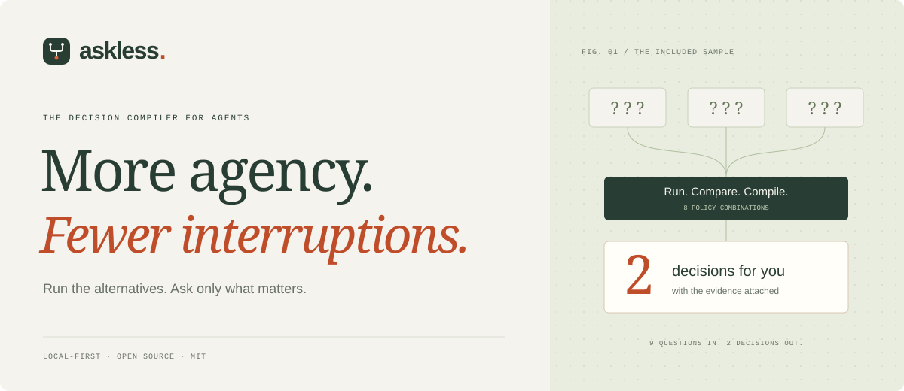
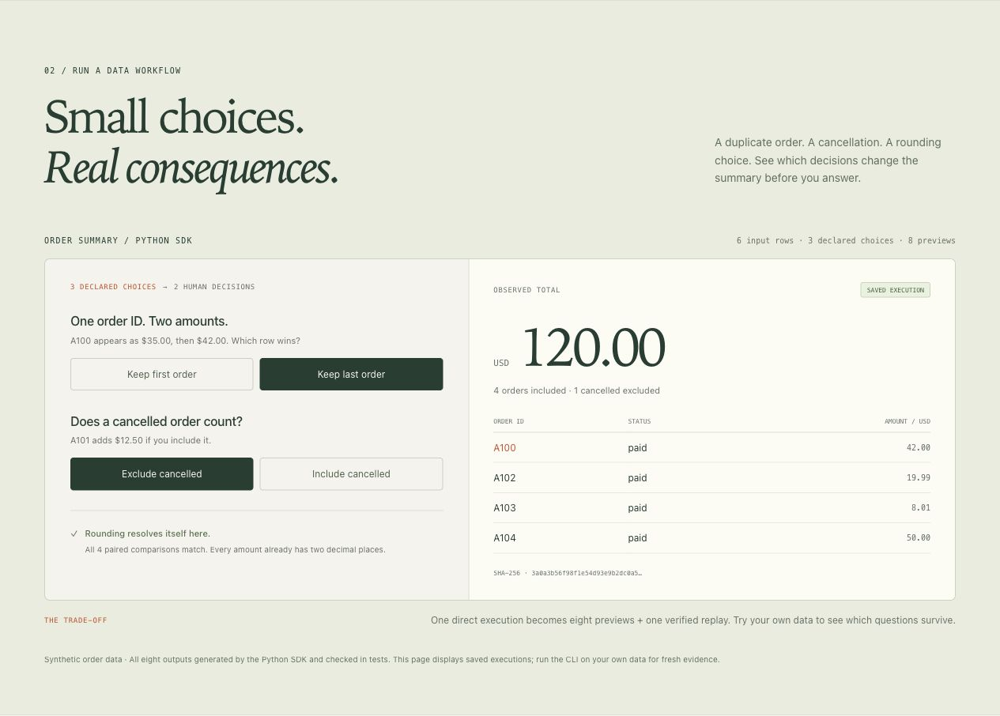
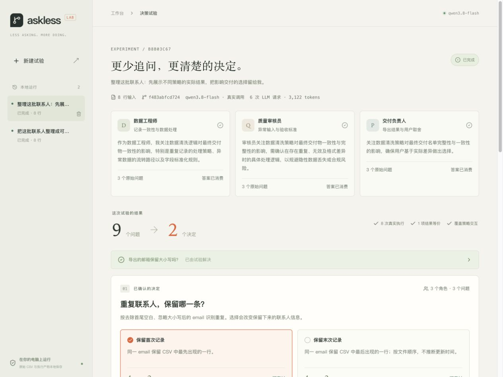

<p align="center">
  <a href="https://oyyp.nexa-lang.com/askless/"></a>
</p>

<p align="center">
  <a href="https://oyyp.nexa-lang.com/askless/"><strong>官网与交互示例 ↗</strong></a>
  &nbsp; · &nbsp; <a href="#五分钟体验">快速开始</a>
  &nbsp; · &nbsp; <a href="docs/python-sdk.md">Python SDK</a>
  &nbsp; · &nbsp; <a href="README.md">English</a>
</p>

<p align="center"><sub>本地优先 &nbsp; / &nbsp; MIT 开源 &nbsp; / &nbsp; Python SDK v0.2</sub></p>

<br />

## 把注意力留给真正重要的决定。

**Run the alternatives. Ask only what matters.**

**让 Agent 花一点算力，替你省一次打断。**

AskLess 先执行备选方案，比较真实产物，再把会影响结果的选择交给人。v0.2 提供可嵌入的 Python SDK、订单数据 Agent，以及可直接打开的 HTML / JSON 证据报告；原有联系人工作台继续可用。

| 声明选择 | 实际执行 | 保留决定 |
| --- | --- | --- |
| 订单去重、取消订单、金额舍入，共 3 项合同 | 完整试跑 8 个组合，比较金额与所有保留、排除记录 | 示例保留 2 项人工决定，舍入在该输入上等价 |

以上来自六行合成订单；模型实际提问数、分支成本和产物一致性在报告中分别记录。人类决策耗时需要实际使用评估。



## 五分钟体验

需要 Python 3.12+ 和 [uv](https://docs.astral.sh/uv/getting-started/installation/)。首次体验无需 API Key 或前端构建。

```bash
git clone https://github.com/ouyangyipeng/askless.git
cd askless
uv sync --frozen
uv run python -m askless.demo \
  --choose duplicates=last \
  --choose cancelled=exclude
```

打开终端打印的 **`report.html` 路径**。报告展示选择、差异证据、所有分支、额外执行成本与最终结果；同目录的 `report.json` 保存完整证据，`result.json` 保存最终订单汇总。上述选项得到 **4 笔订单、总额 120.00 美元**。

每次生成新的 `artifacts/orders-*` 目录，已有目录会被拒绝，避免覆盖历史证据。换用自己的数据：

```bash
uv run python -m askless.demo --input path/to/orders.json
```

终端交互模式会逐项询问剩余选择；非交互模式写入待决定报告并以状态码 2 退出，随后可用 `--choose key=value` 提供答案并重新执行。输入是 1–200 条订单的 JSON 数组，包含 `order_id`、十进制字符串 `amount` 和 `paid` / `cancelled` 状态。详见 [输入格式与执行语义](docs/python-sdk.md#try-the-included-workflow)。

## 接入你的 Python Agent

```python
from pathlib import Path

from askless import explore
from askless.orders import ORDER_DECISIONS, load_orders, preview_orders

data = load_orders(Path("examples/orders.json"))
run = explore(
    adapter="order-summary/v1",
    inputs=data,
    decisions=ORDER_DECISIONS,
    preview=preview_orders,
)

for group in run.pending:
    print(group.decision.prompt, group.decision.options)

# 收集用户对剩余问题的回答，然后复算核验。
result = run.resolve({"duplicates": "last", "cancelled": "exclude"}, inputs=data)
print(result.output)
```

替换合同与 `preview` 函数即可接入自己的任务。每项 `Decision` 支持 2–8 个选项；`AgentQuestion` 把模型真实提问绑定到合同。模型漏问的已注册选择仍会被检查。完整自定义函数示例、失败语义和比较规则见 [SDK 指南](docs/python-sdk.md)。

SDK 完整枚举策略空间，检查其他选项的所有组合；全部结果相同才自动选择第一个选项。用户确认后，原始试跑函数重新执行，精确结果一致才返回 `Resolution`。输入、适配器版本与合同一起形成作用域哈希。

这份订单示例需要八次预览和一次复算，直接执行基线需要一次。报告单列这些成本，并比较相同输入和最终策略的产物。

## 真实 LLM 与离线运行

服务从启动进程的环境读取凭据，支持阿里云的 OpenAI 兼容接口：

| 环境变量 | 用途 |
| --- | --- |
| `ALIYUN_API_KEY` | API 凭据；缺省时读取 `DASHSCOPE_API_KEY` |
| `ALIYUN_BASE_URL` | HTTPS 兼容接口地址，默认 `https://dashscope.aliyuncs.com/compatible-mode/v1` |
| `ASKLESS_MODEL` | 模型名，默认 `qwen3.8-flash`；按账户实际权限设置 |

从已导出这些变量的终端启动即可。程序只读取环境变量，不自动加载 `.env` 或 shell 配置文件。模型需支持 Chat Completions、JSON 输出与 `enable_thinking: false` 参数。

订单示例加 `--live` 后通常调用一次模型，允许模型只提出相关问题。每次请求最多重试一次，连接与读写超时各为 45 秒。发送内容为固定任务、合同及记录数、重复数、取消数、分以下金额数；原始订单 ID 与金额留在本地。预览与最终复算均不调用模型。

默认离线模式为每项合同生成一个声明问题，所有分支都实际执行。[已记录的真实调用](docs/validation-2026-10-26.md) 中，模型提出两项问题，编译器保留两项；离线合同演示从三项选择收敛为两项决定。两类轨迹在报告中分开标注。

## 联系人工作台

安装 Node.js 24.15+（或 22.22.2+）、pnpm 12 后运行 `./run.sh`，打开 [本地工作台](http://127.0.0.1:8765)。脚本安装锁定依赖、构建界面并启动 Python 服务。使用 `Ctrl+C` 停止，可通过 `./run.sh --port 8766` 更改端口。



工作台支持“离线演示”和真实 LLM 模式。真实模式通常进行三次提问和三次策略确认。内置八行合成联系人数据：选择“保留末次记录”和“隔离异常”，得到四条联系人和两条隔离记录。展开问题卡可比较分支，完成后可下载 CSV 与完整证据包。

### 联系人工作台机制

```text
CSV + 任务描述
  ├─ 数据工程师 ─┐
  ├─ 质量审核员 ─┼─ 9 个带合同键的问题
  └─ 交付负责人 ─┘
          ↓
  8 个完整策略组合的本地执行
          ↓
  按合同与数据哈希合并 → 检查全部策略交互
          ↓
  有差异：保留问题 + 两份真实分支产物
  无差异：自动选择等价项 + 保留比较证据
          ↓
  人工确认 → 3 份显式策略回执 → 重新执行并比对哈希 → 下载
```

样例中的九个问题由三个角色按协议各提出三项，编译后有两项待定、一项结果等价。这个样例用于展示机制；人类处理时间、实际协作任务的自然提问分布和验收质量尚待独立实验测量。

**结果等价的范围是当前整批输入与适配器定义的可观察结果。** 比较包含导出记录、隔离记录及阻断状态；完整枚举其他选择，避免在某一个分支里看起来相同就跳过问题。每项选择绑定输入的 SHA-256，回答不会跨数据集自动复用。

联系人工作台的三个角色共用可信 CSV 执行器。v0.2 的自定义 Python 试跑接口独立于该工作台历史。通用编码 Agent 接入、生成代码隔离执行和跨任务偏好学习仍为后续方向。

## 数据与资源边界

**Python SDK：**默认最多 32 个完整分支，可通过 `max_branches` 在 1–256 之间设置；超出预算会在执行前拒绝。输入快照最多 512 KiB，单个结果 64 KiB，全部预览结果 4 MiB，加上元数据。SDK 不写磁盘，示例程序仅写入指定报告目录。

试跑函数是调用方进程中的可信代码，需要纯函数、确定性和有限执行时间。SDK 比较完整声明的 JSON 结果；调用方负责包含全部重要产物，并管理函数耗时、峰值内存与外部副作用。执行外部写入应放在确认与复算之后。

**联系人工作台：**

- 原始 CSV、所有分支结果、回答和回执保存于本地 `.askless/runs.sqlite3`。
- 发送给模型的内容为任务描述、角色、聚合统计、策略合同与确认后的行数/阻断状态。任务描述中输入的信息会发送给配置的模型服务。
- UTF-8 CSV 最大 256 KiB、2,000 行、30 列；必须有唯一的 `email` 列。每个列名最多 128 UTF-8 字节，展开数据最多 512 KiB，防止重复字段名放大存储。
- 单次持久化运行最多 8 MiB，最多保留 50 次运行；最多两次运行同时执行模型或分支任务。单份运行记录的理论数据上限合计为 400 MiB，SQLite 文件还会包含索引、页与可复用空闲空间。
- 历史记录可手动删除。SQLite 通常复用删除后释放的页，文件不会立刻缩小。
- 邮箱执行语法检查，不查询 DNS 或验证投递能力。重复识别按去首尾空白、忽略大小写后的 email；末次记录按文件顺序定义。
- CSV 下载会中和电子表格公式前缀；JSON 证据包保留原始输入，适合核对与复现实验。
- 运行中停止服务会将未完成任务标记为“已中断”；已完成和待决定的运行在重启后保留。可通过 `--data-dir` 指定数据目录。

运行不下载本地模型，不需要 Docker 或独立数据库。实际占用和验收记录见 [本地验证记录](docs/validation-2026-10-23.md)。

## 开发与验证

```bash
uv sync --frozen
uv run pytest -q
uv run ruff check src tests scripts
uv run ruff format --check src tests scripts
uv run isort --check-only src tests scripts
uv run ty check src tests scripts
pnpm --dir web install --frozen-lockfile
pnpm --dir web exec prettier --check src site
pnpm --dir web test
pnpm --dir web build
pnpm --dir web site:build
```

前端开发可另开终端运行 `pnpm --dir web dev`，Vite 将 `/api` 代理到 8765 端口的后端。正常使用时只需要一个 Python 服务，直接提供构建后的页面。

| 位置 | 职责 |
| --- | --- |
| `src/askless/sdk.py` | 有限合同、数据快照、完整策略比较与最终复算 |
| `src/askless/orders.py` / `order_agent.py` | 订单执行语义与可选模型提问 |
| `src/askless/demo.py` / `reporting.py` | 命令行、基线对比和便携证据报告 |
| `src/askless/engine.py` | CSV 验证、真实分支执行、证据比较与问题编译 |
| `src/askless/agents.py` / `llm.py` | 角色协议、模型调用、显式策略回执 |
| `src/askless/service.py` / `store.py` | 生命周期、事务、作用域、并发与存储边界 |
| `src/askless/api.py` | 本地同源 API、导出、静态页面 |
| `web/src/` | React 工作台、问题卡、证据预览、历史记录 |
| `tests/` | 核心行为、错误路径与 HTTP 回归验证 |

接口与状态机见 [架构说明](docs/architecture.md)。官网源文件位于 `web/site/`，复用工作台依赖；`pnpm --dir web site:dev` 可本地预览。GitHub Pages 发布方式与示例更新方法见 [官网维护说明](docs/website.md)。

欢迎贡献有明确执行语义的新适配器、策略交互测试，以及人类决策时间与任务质量的评估方案。参见 [贡献指南](CONTRIBUTING.md)。本项目采用 [MIT License](LICENSE)。
